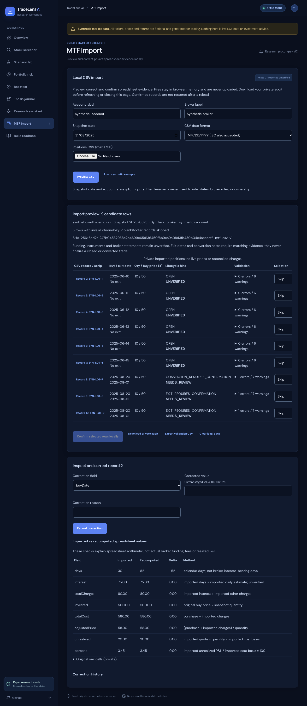

# MTF Phase 2 — private CSV staging and review

Phase 2 extends the existing Phase 1 branch. The MTF event/calculation engine
remains unchanged; there is no MTF database/API, broker connection or portfolio
dashboard in this change.

## Try it in the UI

1. Run `npm ci` then `npm run dev`.
2. Open the app at http://localhost:5173 and choose **MTF Import**.
3. Choose **Load synthetic example** for nine wholly invented rows, including
   three chronology failures. Alternatively provide account/broker labels,
   snapshot date and date format, choose a private CSV, then click **Preview CSV**.
4. Expand row diagnostics. Click a row to inspect its source cells and arithmetic.
   Select a correction field, enter the value/reason and record the correction.
5. Explicitly select individual rows for review or acceptance as unverified
   evidence. Critical errors disable automatic acceptance; review keeps the
   rejected evidence without finalizing a position.
6. Confirm the selected rows locally. Download the private JSON audit and/or
   formula-safe validation CSV. Clear local data when finished.

No personal data appears in that screenshot. The file upload, parsing, corrections,
confirmation and download run in browser memory. Nothing is sent to the API,
research provider, telemetry, localStorage or sessionStorage. Switching app tabs
preserves the workspace. Refresh/close discards it; an unload warning and download
actions make that limit explicit. JSON downloads include private raw cells and
correction records: keep them private. No restore/persistent ledger is implemented.

## Import and reconciliation contract

- Parser supports UTF-8 BOM, CRLF/LF, quoted cells/commas, escaped quotes and
  multiline notes. Limits: 1 MiB, 5,000 data records, 64 columns, 16,384 characters
  per cell. Malformed quoting, NUL, duplicate recognized headers and missing
  required columns fail the preview before storing anything.
- Required headers identify Scrip, Buy Date, Buy Price and No of Shares. The
  legacy `Intreset Till Now` spelling is supported. Unnamed column 19 maps to a
  note; ancillary columns and all candidate source cells stay in the raw audit.
  Unknown named columns are preserved with a warning, never silently discarded.
- Blank rows and explicit total/footer rows are counted separately. Symbol-less
  aggregate-only rows are footers; symbol-less trade-like rows remain rejected
  candidates. Extra nonempty cells beyond the header width are critical errors.
- Metadata is explicit: local scope/account, broker label, snapshot date and
  configured date format. No filename-derived chronology or broker/funding guess.
- Dates accept strict ISO, or strict MM/DD/YYYY when configured. Impossible
  dates, exits before entry and dates beyond the supplied snapshot are errors.
- Amounts use decimal arithmetic with plain/western/Indian grouping, optional
  rupee prefix and percentage suffix. Missing values and #N/A become null,
  never zero. Negative days/interest/costs, nonpositive prices and invalid share
  quantities are errors. Signed spreadsheet P&L is retained only as evidence.
- Preview includes lifecycle hints, confidence, error/warning codes, missing
  funding/rate/instrument/quote-date diagnostics, outlier daily-estimate warnings,
  and imported/recomputed/delta/method columns. The daily outlier threshold is a
  deliberately broad 1% of gross notional, an anomaly heuristic, not a broker rate.
- Recomputed values explain the spreadsheet's own arithmetic: purchase notional,
  reported-days × reported-daily-interest, total charges, adjusted basis/price,
  imported-price unrealized P&L and percent. Calendar days are independently
  derived from entry/exit/snapshot. These are not actual interest calculations,
  broker reconciliation, financing inference, realized P&L or leveraged ROI.
- Exit dates/sell prices/conversion notes are hints requiring trade/conversion
  evidence later. No canonical sale, conversion, loan, charge or MTF lot is created
  by accepting a row. Confirmed evidence remains IMPORTED_UNVERIFIED, with
  ACCEPTED_UNVERIFIED or NEEDS_REVIEW disposition, outside all open MTF totals.

`MtfImportWorkspace` owns private previews and confirmed evidence in memory.
Returned objects are detached copies. Corrections preserve original raw cells
and record before/after, field, reason and timestamp; they trigger revalidation.
A confirmed preview cannot be edited retroactively. SHA-256 content checksums,
scoped preview IDs and row fingerprints identify retries/duplicates. Same-symbol
multi-buy rows require review rather than symbol-only lot matching. Potential
cross-file position duplicates block automatic acceptance. Identical row imports
cannot add another record, including review duplicates. Repeating an identical
confirmation returns its original receipt; conflicting selections are rejected.
All selected rows validate before the single in-memory commit; failure never
partially saves an import. Audit chronology is monotonic. These are local-domain
invariants, not a replacement for authenticated database transactions in Phase 3.

CSV export quotes every cell and prefixes dangerous spreadsheet formula markers
(including whitespace-obscured =, +, -, @ and leading control characters) with an
apostrophe. Original raw evidence is available only in the explicit private JSON
export; it must not be published or opened as an automatically trusted spreadsheet.

## Reference audit and verification

The private reference file became available during Phase 2. A local dry-run
through the implemented parser found **nine candidate rows**, with **three rows
having invalid chronology**, plus negative-value diagnostics. Only counts/codes
were emitted, no holdings, amounts or raw cells. The reference file is explicitly
Git-ignored, never uploaded and not part of tests, screenshots or commits.

Automated fixtures are wholly synthetic. Validation performed:

- `npm test`: 166 passed, 0 failed; includes 23 new Phase 2 test cases and the
  existing Phase 1/API/domain tests.
- `npm run test:e2e`: 6 Chromium tests passed, including 4 new import tests for
  preview/correction/confirmation/download, upload, malformed input, mobile width,
  keyboard activation, tab retention and absence of POST requests/private storage.
- `npm run typecheck`: passed.
- `npm run build`: passed.
- `git diff --check`: passed.

Phase 2 modules: `csv.ts`, `importTypes.ts`, `importValidation.ts`,
`importWorkspace.ts`, `demoImport.ts`, MTF barrel exports, React `MtfImport.tsx`,
navigation/styles, unit/browser tests, this document, README and the private-file
ignore rule. Phase 1 files/dependency changes are included in the same PR because
that branch had not yet been committed/published.

## Remaining phases

Phase 3 adds authenticated/scoped persistent event storage, transactional writes,
migrations/indexes/backups and API endpoints. It must explicitly resolve imported
instruments/lots and collect authoritative fills/funding/charge evidence before
converting staged evidence into canonical ledger events. Phase 4 builds the full
MTF dashboard and lifecycle totals. Phase 5 adds quote/history/projection work;
Phase 6 is separately authorized read-only broker integration. This import screen
is **not real-time, not broker-connected and not reconciled**.
